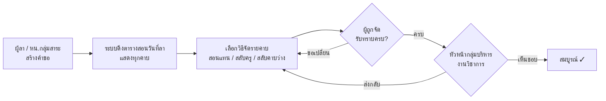

# ระบบจัดสอนแทน — เอกสารออกแบบระบบ (v1.0)

โรงเรียนกาญจนาภิเษกวิทยาลัย สุราษฎร์ธานี · ภาคเรียนที่ 2 ปีการศึกษา 2569
ระบบจริง: Google Apps Script + Google Sheet (ติดตั้งตาม [`INSTALL.md`](INSTALL.md)) · ทดลอง: [`Substitution-Demo-2-2569.html`](Substitution-Demo-2-2569.html)

ภาคเรียน 28 ต.ค. 2569 – 26 ก.พ. 2570 · ธีมสว่างโทนครีม

---

## 1. ข้อมูลตั้งต้นและผลการวิเคราะห์ตารางสอน

### 1.1 แหล่งข้อมูล
| ไฟล์ใน repo | ใช้ทำอะไร |
|---|---|
| `Dashboard-2-2569.html` (อัปเดต 29 ต.ค. 69) | **แหล่งข้อมูลหลัก** — ตารางสอนรายครู 77 คน, ตารางเรียนรายห้อง 39 ห้อง, กลุ่มสาระของครู, เวลาคาบ |
| `KJST_TimeTable_Studio_2-2569.html` | ใช้เฉพาะข้อมูล **เวร** (เวรตรวจรับอาหาร ฯลฯ) และคาบพักกลางวันของแต่ละระดับ |

`build.py` ดึงข้อมูลจากไฟล์ทั้งสองมาเป็น `gas/TimetableData.html` (นำเข้าตอน `setup`) และผู้ดูแลนำเข้าตารางใหม่ได้จากหน้าตั้งค่า (ไฟล์ Excel จากโรงเรียนจะเพิ่มตัวนำเข้าเมื่อได้รับไฟล์)

> ✅ ยืนยันแล้วว่าใช้ Dashboard · **หมายเหตุเดิม: ข้อมูลสองไฟล์ไม่ตรงกัน**: ไฟล์ Studio ยังเป็นตารางร่างที่จัดอัตโนมัติ (ต่างจาก Dashboard 558 ช่อง และมีครู `Mr. Youcef Benai` แทน `Mr.Joemari Batchecha Asuncion`) — ระบบจึงใช้ Dashboard เป็นหลัก ควรยืนยันว่า Dashboard คือตารางที่ใช้จริง

### 1.2 โครงสร้างตาราง
- 5 วัน × 10 ช่วง: ช่วง 0 = โฮมรูม 08.00–08.20 · **คาบ 1–9** (50 นาที) 08.20–15.50
- ครู 77 คน ใน 9 กลุ่มสาระ: วิทย์ฯ 24 · ต่างประเทศ 13 · คณิต 12 · สังคมฯ 8 · ไทย 6 · ศิลปะ 4 · การงานฯ 4 · สุขศึกษาฯ 4 · กิจกรรม/แนะแนว 2
- คาบสอนจริงรวม 1,405 คาบ/สัปดาห์ (เฉลี่ย 18.2 คาบ/คน) ครูสอนวันละ 3–5 คาบเป็นส่วนใหญ่ (321 จาก 385 วัน·คน)

### 1.3 ประเภทช่องในตาราง และวิธีที่ระบบจัดการ
| ประเภท | รหัส | ต้องจัดสอนแทน? | นับว่าครู "ไม่ว่าง"? |
|---|---|---|---|
| คาบสอนปกติ | รหัสวิชา | ✅ | ✅ |
| โฮมรูม / ประชุมระดับ / PLC / ประชุมฝ่าย | HR, MEET, PLC, ประชุม | ❌ | ✅ |
| ชุมนุม / ลูกเสือ (พร้อมกันทั้งโรงเรียน/ระดับ) | ชุมนุม, ลูกเสือ | ✅ ต้องระบุ แต่ครูทุกคนติดกิจกรรม → มีตัวเลือก “ฝากครูร่วมกิจกรรมดูแล” (หรือสลับคาบได้) | ✅ |
| สอนร่วม (ครู ≥ 2 คน) — 102 ช่อง | | ตัวเลือก “ครูร่วมสอนดูแล” ได้ | ✅ |
| เวร (จากไฟล์ Studio) | | — | ⚠️ แสดงคำเตือน ไม่ตัดสิทธิ์ |

### 1.4 จำนวนครูว่างต่อคาบ (ตามตารางปกติ ทั้งโรงเรียน)
| | 1 | 2 | 3 | 4 | 5 | 6 | 7 | 8 | 9 |
|---|---|---|---|---|---|---|---|---|---|
| จันทร์ | 36 | 41 | 37 | 58 | 54 | 29 | 38 | 48 | 32 |
| อังคาร | 37 | 44 | 29 | 56 | 53 | 33 | 46 | 33 | 19 |
| พุธ | 35 | 44 | 28 | 56 | 63 | 30 | 37 | **13** | **0** |
| พฤหัสบดี | 35 | 46 | 41 | 57 | 51 | 36 | 32 | 31 | 30 |
| ศุกร์ | 38 | 46 | 38 | 57 | 57 | 28 | 38 | 39 | 41 |

ข้อสังเกตที่มีผลต่อการออกแบบ
- **พุธ คาบ 8–9** (ลูกเสือ/ชุมนุม) แทบไม่มีครูว่าง — ระบบจัดเป็นกิจกรรมที่ไม่ต้องหาผู้สอนแทน
- คาบ 4–5 มีครูว่างมากเพราะเป็นช่วงพักกลางวันของบางระดับ (ม.1, 3, 5 พักคาบ 4 · ม.2, 4, 6 พักคาบ 5)
- **ช่องที่ไม่มีครูกลุ่มเดียวกันว่างเลย**: ศิลปะ 15 ช่อง, การงานฯ 10, ภาษาไทย 5, สุขศึกษาฯ 5, คณิต 4 (เช่น พุธ คาบ 1, 3), สังคมฯ 4 → ระบบต้องแสดงครูต่างกลุ่มสาระต่อท้ายเสมอ และมีทางเลือก “สลับคาบ”
- ครู 2 คนไม่มีคาบสอนในตาราง (ภาระ 0) จะขึ้นอันดับต้น ๆ เสมอเมื่อเรียงตามภาระ → ใช้ “จำนวนสอนแทนสะสม” เป็นเกณฑ์รองเพื่อกระจายภาระ (ดู 4.1)

---

## 2. ผู้ใช้และสิทธิ์

| บทบาท | ทำอะไรได้ |
|---|---|
| **ครู** | แจ้งลา/จัดสอนแทนของตนเอง (ทุกกรณี) · รับทราบ/ขอเปลี่ยนคาบที่ถูกจัด · ดูตารางสอนแทนรายวัน · ดูสถิติ |
| **หัวหน้ากลุ่มสาระฯ** | สิทธิ์ครู + จัดสอนแทน **กรณีลาป่วย** ให้ครูในกลุ่มสาระ · ดูรายการของกลุ่มสาระ |
| **หัวหน้ากลุ่มบริหารงานวิชาการ** | **เห็นชอบ / ส่งกลับ** · จัดแทนได้ทุกกรณี (กรณีฉุกเฉิน) · ดูบันทึกระบบ · ตั้งค่า |
| ผู้ดูแลระบบ | ตั้งค่า, นำเข้าตารางสอน, จัดการผู้ใช้ |
| (ทางเลือก) ผู้บริหาร | ดูอย่างเดียว: ตารางรายวัน, สถิติ |

หัวหน้ากลุ่มสาระและหัวหน้าวิชาการกำหนดในหน้า **ตั้งค่า** (ใน mockup เป็นค่าสมมติ)

## 3. กรณีการลาและกฎ

| กรณี | ผู้จัด | ช่วงวันที่จัดได้ |
|---|---|---|
| ลากิจ | ผู้ลาเอง | ล่วงหน้า ≥ 1 วัน ถึง +30 วัน |
| ไปราชการ | ผู้ไปราชการเอง (แนบคำสั่ง/หนังสือ) | ล่วงหน้า ≥ 1 วัน ถึง +30 วัน |
| ติดภารกิจอื่น | ผู้ติดภารกิจเอง | ล่วงหน้า ≥ 1 วัน ถึง +30 วัน |
| ลาป่วย | ผู้ลาเอง **หรือ** หัวหน้ากลุ่มสาระฯ | **วันนี้** ถึง +30 วัน |

- “ล่วงหน้าได้ 1 เดือน” = วันที่ลาต้องไม่เกิน วันนี้ + 30 วัน (ปรับได้ในตั้งค่า)
- ระยะล่วงหน้าขั้นต่ำ (1 วัน) ปรับได้ · หัวหน้าวิชาการจัดแทนได้ทุกกรณีแม้เป็นวันเดียวกัน
- นับเฉพาะวันเรียน: ข้ามเสาร์–อาทิตย์ วันหยุดในตั้งค่า และวันนอกภาคเรียน (28 ต.ค. 69 – 26 ก.พ. 70)
- **ลาทั้งวันหรือบางคาบได้** (เลือกคาบรายวัน) — คาบอื่นของวันนั้นผู้ลายังถูกจัดให้สอนแทน/รับคาบสลับได้
- ห้ามมีคำขอซ้อนช่วงเวลาเดียวกันของครูคนเดียวกัน

## 4. วิธีจัด 3 แบบ (+1)

### 4.1 จัดครูสอนแทน — ลำดับรายชื่อ
สำหรับคาบ (วันที่ D, คาบ p) ของครู A:

```
ผู้สมัคร = ครูทุกคน ≠ A ที่ "ว่างจริง" ณ (D, p)
ว่างจริง  = ไม่ลา/ไปราชการในวัน D
          และ ไม่มีคาบในตารางปกติ (เว้นแต่คาบนั้นถูกสลับออกไปแล้ว)
          และ ยังไม่ถูกจัดให้สอนแทน/สลับคาบในช่องนั้น (ทุกคำขอที่ยังไม่ยกเลิก รวมที่รอรับทราบ)
          และ ไม่ใช่คนที่เคย "ขอเปลี่ยน" คาบนี้ไปแล้ว
เรียงลำดับ:
  1) กลุ่มสาระเดียวกับ A ก่อน แล้วจึงครูต่างกลุ่มสาระ
  2) จำนวนคาบสอนในวัน D จากน้อยไปมาก   (ตารางปกติ + สอนแทน/สลับที่ถูกจัดแล้ว)
  3) จำนวนสอนแทนสะสมทั้งภาคเรียน น้อยไปมาก   (เกณฑ์เสริม เพื่อความเป็นธรรม)
  4) ชื่อ ก–ฮ
```
- แสดงแถบภาระวันนั้น: สีน้ำเงิน = คาบปกติ, สีทอง = สอนแทนที่ถูกจัดแล้ว
- แสดงรายชื่อ **“ว่างตามตารางปกติ แต่ไม่ว่างจริง”** พร้อมเหตุผล (เช่น “ถูกจัดสอนแทน ม.2/3 ให้ … แล้ว”, “ลากิจในวันนี้”) เพื่อให้ตรวจสอบได้
- ⚠️ แสดงคำเตือนถ้าครูมีเวรในคาบนั้น

### 4.2 สลับคาบกับครูอื่น
A แลกคาบกับครู B ที่สอน **ห้องเดียวกัน**:
- B มาสอนห้องนี้ใน (D, p) และ A ไปสอนแทน B ในคาบ (D′, p′) ของ B
- เงื่อนไข: B ว่างจริง ณ (D, p) · A ว่างจริง ณ (D′, p′) · D′ ไม่ใช่วันที่ A ลา · คาบของ B ยังไม่ถูกสลับไปแล้ว · ไม่ใช่คาบสอนร่วม
- ค้นหา D′ ในช่วง 7 วันก่อน – 14 วันหลัง (ไม่เกินขอบ 30 วัน) เรียงตามความใกล้กับวันลา
- B ต้องกดรับทราบ · ห้องเรียนไม่เสียคาบ และไม่ต้องใช้ครูนอกห้อง

### 4.3 สลับคาบว่าง (ย้ายไปสอนชดเชย)
ย้ายคาบ (D, p) ของ A ไปคาบ (D′, p′) ที่ **ห้องว่าง** และ **A ว่าง**
- ไม่เลือกคาบพักกลางวันของระดับนั้น · ไม่ซ้อนกับการย้ายอื่นเข้าห้องเดียวกัน
- ไม่มีผู้ต้องรับทราบ (หัวหน้าวิชาการยังต้องเห็นชอบ)

### 4.4 ครูร่วมสอนดูแล
แสดงเฉพาะคาบสอนร่วมที่ครูร่วมไม่ได้ลา

> ใช้ได้เฉพาะห้องเรียนปกติ — กลุ่มเลือก/กลุ่มเรียนรวม (เช่น “เลือกตามความสนใจ ม.4 กลุ่ม 3”) สลับไม่ได้ ให้ใช้ครูสอนแทน

## 5. ขั้นตอนการทำงานและสถานะ



| สถานะคำขอ | ความหมาย |
|---|---|
| **รอรับทราบ** | ยังมีคาบที่ผู้ถูกจัดยังไม่กดรับทราบ (แสดง x/y) |
| **ต้องจัดใหม่** | มีผู้ถูกจัด “ขอเปลี่ยน” → ผู้จัดเลือกคนใหม่เฉพาะคาบนั้น |
| **รอเห็นชอบ** | รับทราบครบ → เข้าคิวหัวหน้าวิชาการ |
| **สมบูรณ์** | หัวหน้าวิชาการเห็นชอบแล้ว |
| ส่งกลับแก้ไข | หัวหน้าวิชาการส่งกลับพร้อมเหตุผล → แก้ไขและส่งใหม่ (คาบที่ไม่เปลี่ยนคงการรับทราบเดิมไว้) |
| ยกเลิก | ผู้จัดยกเลิก (คืนเวลาว่างให้ทุกคนทันที) |

สถานะคำขอ **คำนวณจากสถานะรายคาบ** ระบบจึงไม่มีทางที่สถานะจะขัดกันเอง

- คาบที่รอรับทราบ “จองเวลา” ครูไว้แล้ว ทำให้คนอื่นจัดชนไม่ได้
- คาบที่ถูก “ขอเปลี่ยน” คืนเวลาว่างทันที
- เตือนเมื่อผู้ลามีภาระสอนแทนผู้อื่นอยู่ในวันที่ลา

## 6. หน้าจอ (ตาม mockup)

| หน้า | เนื้อหา |
|---|---|
| เข้าสู่ระบบ | ชื่อผู้ใช้/รหัสผ่าน e-Score |
| หน้าหลัก | KPI วันนี้ · สิ่งที่ต้องทำ · ตารางสอนแทนวันนี้ · ตารางสอนของฉัน (รวมสอนแทน) · คำขอล่าสุด |
| จัดสอนแทน | ① ผู้ลา วันที่ กรณี เหตุผล ไฟล์แนบ → ② การ์ดรายคาบ เลือกวิธี/ผู้สอนแทน (ปุ่ม “เติมอัตโนมัติ” เลือกอันดับ 1) → ③ ตรวจสอบและส่ง |
| รอฉันรับทราบ | การ์ดคาบที่ถูกจัด ปุ่ม **รับทราบ / ขอเปลี่ยน** / รับทราบทั้งหมด · คาบสอนแทนที่จะถึง |
| รายการจัดสอนแทน | แท็บ ของฉัน / ฉันถูกจัด / กลุ่มสาระฯ / ทั้งหมด |
| เห็นชอบ | คิว รอเห็นชอบ (เลือกหลายรายการแล้วเห็นชอบพร้อมกันได้) · รอรับทราบ · ต้องจัดใหม่ · สมบูรณ์ |
| ตารางสอนแทนรายวัน | เรียงตามคาบ: ห้อง วิชา ครูเดิม วิธี ผู้สอน สถานะ · **พิมพ์** ติดบอร์ด |
| สถิติ | KPI · รายกลุ่มสาระ · แผนภาพวัน×คาบ · ตารางรายบุคคล (คลิกดูบันทึกละเอียด) · ส่งออก CSV |
| บันทึกระบบ | Audit log ทุกการกระทำ ค้นหาได้ |
| ตั้งค่า | หัวหน้ากลุ่มสาระ, หัวหน้าวิชาการ, วันหยุด, เปิด–ปิดภาค, กฎจำนวนวันล่วงหน้า |
| รายละเอียดคำขอ | ขั้นตอน 4 ขั้น · ตารางรายคาบ + เวลารับทราบ · ประวัติ (timeline) · พิมพ์ **บันทึกการจัดสอนแทน** |

## 7. บันทึกข้อมูลและสถิติ

### 7.1 โครงสร้างข้อมูล (ตาราง)
```
users            (user_id, escore_username, teacher_id, role[], active)
teachers         (teacher_id, name, dept_id)
departments      (dept_id, name, head_teacher_id)
timetable_slots  (term, teacher_id, weekday, period, subject_code, subject_name, class, room)  ← นำเข้าจาก Dashboard
class_slots      (term, class, weekday, period, subject_code, teacher_ids[])
calendar         (date, is_school_day, note)            ← วันหยุด/กิจกรรมโรงเรียน
duties           (teacher_id, weekday, period, label)

requests         (request_id, type, teacher_id, arranged_by, date_from, date_to, reason, attachment_url,
                  status[open|approved|returned|cancelled], return_note,
                  created_at, approved_by, approved_at)
request_items    (item_id, request_id, date, period, subject_code, class, room,
                  method[sub|swap_teacher|swap_free|co_teacher|none],
                  sub_teacher_id, swap_teacher_id, swap_date, swap_period,
                  ack_status[pending|ack|declined|n/a], ack_at, decline_note, declined_by[])
audit_log        (log_id, at, user_id, action, request_id, item_id, detail_json)   ← บันทึกเพิ่มอย่างเดียว ห้ามแก้
notifications    (id, user_id, kind, ref, created_at, read_at)
```
ป้องกันการจองชนในฐานข้อมูล: unique index ที่ (`sub_teacher_id`, `date`, `period`) และ (`swap_teacher_id`, `date`, `period`) สำหรับรายการที่ยังมีผล — ถ้าสองคนกดพร้อมกัน ระบบรับได้คนเดียว

### 7.2 สถิติ
- **ผู้ลา/ผู้ถูกสอนแทน**: จำนวนครั้งและวันแยกตามกรณี · คาบที่ต้องจัด · คาบที่หัวหน้ากลุ่มสาระจัดให้ · จำนวนสลับคาบ (ครู/คาบว่าง)
- **ผู้สอนแทน**: จำนวนคาบที่สอนแทน · จำนวนครั้งที่เป็นคู่สลับ · จำนวนครั้งที่ขอเปลี่ยน
- **ผู้จัด**: ใครจัด จัดเมื่อไร (ล่วงหน้ากี่วัน)
- **ภาพรวม**: รายกลุ่มสาระ (คาบที่ต้องหาคนแทน กับ คาบที่ช่วยสอนแทน) · แผนภาพวัน×คาบ · อัตราสมบูรณ์ · เวลาเฉลี่ยจนรับทราบ · สัดส่วนผู้สอนแทนกลุ่มเดียวกัน
- ส่งออก CSV/Excel รายคาบครบทุกฟิลด์ (สำหรับ ปพ./รายงานผู้บริหาร)

## 8. การเข้าสู่ระบบด้วยบัญชี e-Score (ทำแล้ว)
- ระบบอ่านชีต **Users** ของไฟล์ e-Score แบบอ่านอย่างเดียว (`ESCORE_SPREADSHEET_ID`) ตรวจหาคอลัมน์ username/password/ชื่อ/อีเมล อัตโนมัติ (รองรับหัวคอลัมน์ไทย/อังกฤษ) หรือกำหนดเองได้
- รหัสผ่าน: ข้อความธรรมดา, SHA-256 (hex/base64), MD5 — ตรวจอัตโนมัติ
- จับคู่บัญชีกับรายชื่อครูจาก **ชื่อ-สกุล** (ไม่สนคำนำหน้า เช่น น.ส./นางสาว) และผู้ดูแลจับคู่เองได้ (ชีต `UserMap`)
- session token อายุ 6 ชม. (CacheService) · ใส่รหัสผิด 5 ครั้งล็อก 10 นาที · บันทึกการเข้าใช้ใน Log
- บทบาท: `ACAD_USERS` = หัวหน้ากลุ่มบริหารงานวิชาการ, `ADMIN_USERS` = ผู้ดูแล, หัวหน้ากลุ่มสาระฯ ตั้งในหน้าตั้งค่า

## 9. การแจ้งเตือน
- ในระบบ: กระดิ่ง + ตัวเลขบนเมนู (หน้าเว็บดึงข้อมูลใหม่ทุก 60 วินาที)
- อีเมล (เลือกเปิดได้): ถูกจัด/มีผู้ขอเปลี่ยน/รับทราบครบ (แจ้งหัวหน้าวิชาการ)/เห็นชอบ/ส่งกลับ/ยกเลิก

## 10. สถาปัตยกรรมที่สร้าง
```
เบราว์เซอร์ (Index.html)  ──google.script.run──▶  Code.gs (Apps Script, รันในนามผู้ติดตั้ง)
   SubEngine (คำนวณตัวเลือก)                        SubEngine (ตรวจซ้ำก่อนบันทึก) + LockService
                                                    ├─ Google Sheet ฐานข้อมูล (Requests, Items, Log, …)
                                                    └─ Google Sheet e-Score › Users (อ่านอย่างเดียว)
```
- **กฎชุดเดียวกัน** (`src/engine.js`) ใช้ทั้งหน้าเว็บและ server — หน้าเว็บคำนวณรายชื่อทันที, server คำนวณซ้ำทุกครั้งที่บันทึก
- ทุกการบันทึกอยู่ใน `LockService` → อ่านข้อมูลล่าสุด → ตรวจ → เขียน: ถ้าสองคนเลือกครูคนเดียวกันช่องเดียวกันพร้อมกัน คนที่สองถูกปฏิเสธพร้อมข้อมูลล่าสุด
- ข้อมูลเก็บเป็นข้อความ (กัน Sheets แปลงวันที่เอง) และอ้างอิงครูด้วยชื่อ จึงนำเข้าตารางสอนใหม่ได้โดยประวัติไม่หาย

## 11. การทดสอบ
- `test/test_server.js` 58 กรณี: ติดตั้ง, ล็อกอิน (hash/คำนำหน้า/ล็อกบัญชี), สิทธิ์, กฎวันที่, กันจองซ้ำ, ลาบางคาบ, รับทราบ/ขอเปลี่ยน/จัดใหม่/เห็นชอบ, ยกเลิก, ส่งกลับ-แก้ไข, สลับคาบทั้ง 2 แบบ, ตั้งค่า, นำเข้าตาราง
- `test/test_e2e.js` 34 กรณีผ่านเบราว์เซอร์จริง ครบ 4 บทบาท และตรวจจอมือถือ

## 12. สิ่งที่ยังรอ
1. ไฟล์ Excel ตารางสอน → เพิ่มตัวนำเข้าจาก Excel
2. ยืนยันรูปแบบรหัสผ่านใน e-Score (รัน `testEscore` จะบอกรูปแบบที่พบ)
3. รายชื่อหัวหน้ากลุ่มสาระฯ และวันหยุด/วันสอบของภาคเรียน (ตั้งในหน้าตั้งค่า)
